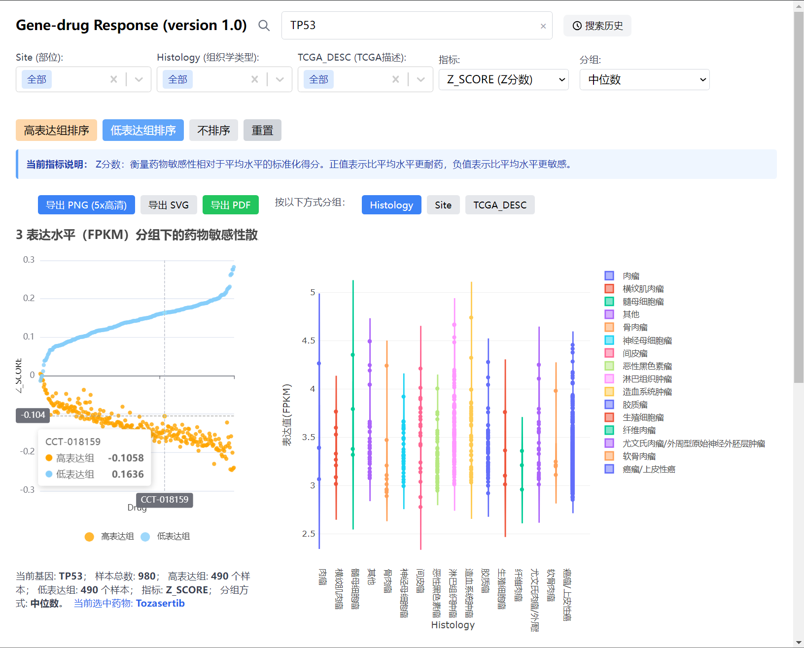
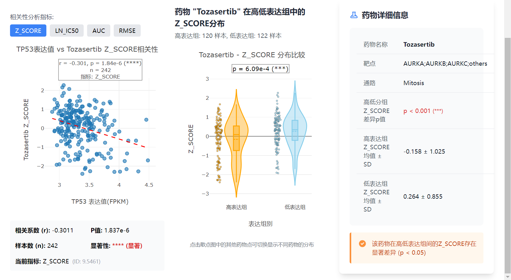

[](README.en.md)
[](README.md)

# Gene Drug Visualizer

An interactive desktop application for exploring gene expression and drug sensitivity relationships, powered by data from the **GDSC (Genomics of Drug Sensitivity in Cancer)** project.

## Features

- **Gene Search** — Search gene names with autocomplete suggestions
- **Correlation Scatter Plot** — Visualize expression vs drug sensitivity for any gene and metric
- **Violin Plot** — Expression distribution grouped by tissue, histology, or TCGA classification
- **Drug Response Analysis** — Explore IC50, AUC, RMSE, and Z_SCORE metrics
- **Interactive Interface** — Built with React and Plotly for rich, responsive charts

## Screenshots





## Download

Pre-built Windows installers are available on the [Releases page](https://github.com/bingshaowei/GeneDrugVisualizer/releases).

**Requirements:**
- Windows 10 / 11 (64-bit)
- No additional software required — Python 3.11 and all dependencies are bundled

## Documentation

- [User Manual (English)](docs/User Manual.docx)
- [Software Copyright Certificate (Chinese)](docs/软件证书.pdf)

## Development

### Prerequisites

- Node.js 22.x (>=22.22.2), 24.x (>=24.15.0), or 26+, plus npm 11+
- Python 3.11.9 for development; release setup downloads the embedded runtime automatically
- Git LFS (required to fetch real CSV data)

### Quick Start

```bash
# Clone the repository
git clone https://github.com/bingshaowei/GeneDrugVisualizer.git
cd GeneDrugVisualizer
git lfs install --local
git lfs pull

# Install frontend dependencies
cd frontend && npm install && cd ..

# Start the Flask backend
cd backend
python -m pip install --require-hashes --only-binary=:all: -r requirements-release.lock
python app.py &
cd ..

# Start the frontend dev server
cd frontend && npm start
```

The frontend development server uses Vite at `http://127.0.0.1:3000` and proxies API requests to the local Flask service at `http://127.0.0.1:5000`.

### Build Installer

```powershell
# One-click build (recommended)
scripts\build.bat

# Use a new, isolated output directory
scripts\build.bat electron\dist-verify-v1.1.1

# Or step by step:
# 1. Run from the project root; choose an output directory that does not exist
$releaseOutput = Join-Path (Get-Location) "electron\dist-verify-v1.1.1-manual"
if (Test-Path -LiteralPath $releaseOutput) { throw "Choose a new release output directory." }

# 2. Prepare the locked Python environment, verify real data, and run backend tests
scripts\download-python.bat
if ($LASTEXITCODE -ne 0) { throw "Python preparation failed." }
$pythonExe = Join-Path (Get-Location) "electron\python-embedded\python.exe"
& $pythonExe -B scripts\validate-data.py --data-dir backend\data --manifest backend\data-manifest.json
if ($LASTEXITCODE -ne 0) { throw "Data validation failed." }
& $pythonExe -B -m unittest discover -s backend\tests -v
if ($LASTEXITCODE -ne 0) { throw "Backend or release validator tests failed." }

# 3. Install, audit, test, and build the frontend
cd frontend
npm ci
if ($LASTEXITCODE -ne 0) { throw "Frontend installation failed." }
npm run audit:security
if ($LASTEXITCODE -ne 0) { throw "Frontend audit failed." }
npm test
if ($LASTEXITCODE -ne 0) { throw "Frontend tests failed." }
npm run build
if ($LASTEXITCODE -ne 0) { throw "Frontend build failed." }
cd ..

# 4. Install, audit, test, and package Electron for Windows x64
cd electron
npm ci
if ($LASTEXITCODE -ne 0) { throw "Electron installation failed." }
npm run audit:security
if ($LASTEXITCODE -ne 0) { throw "Electron audit failed." }
npm test
if ($LASTEXITCODE -ne 0) { throw "Electron tests failed." }
npx electron-builder --win --x64 --publish never --config.directories.output="$releaseOutput"
if ($LASTEXITCODE -ne 0) { throw "Installer build failed." }
cd ..

# 5. Validate packaged files, dependencies, data, and real backend requests
powershell.exe -NoProfile -ExecutionPolicy Bypass -File scripts\verify-release.ps1 -DistPath "$releaseOutput"
if ($LASTEXITCODE -ne 0) { throw "Release validation failed." }
```

The build prepares Python, verifies data and runs backend tests, installs and audits frontend dependencies, tests and builds the frontend, installs and audits Electron dependencies, tests Electron, packages Windows x64, and validates the release. Any failure stops the chain.

The default output is `electron/dist`. Relative output paths are always resolved against the project root; absolute paths are supported. The output directory must be absent or empty. Existing artifacts are never automatically cleaned.

The release runtime is Windows x64 / Python 3.11.9. `backend/requirements-release.lock` pins all dependencies and wheel SHA-256 hashes, retaining Flask 2.2.5, Pandas 1.5.3, NumPy 1.26.4, and Werkzeug 2.3.8 as the compatibility baseline. Setup installs in a separate staging directory with `--require-hashes --only-binary=:all:`, verifies exact versions, runs `pip check`, and imports Flask/Pandas before copying to a new embedded runtime directory. An existing directory with mismatched or missing dependencies fails explicitly; it is never overwritten, downgraded, or repaired. Build in a separate fresh checkout instead. Failed staging files are retained; verify paths before cleaning them yourself.

Both CSVs use Git LFS. Run `git lfs pull` after cloning; source ZIPs and checkouts without LFS may contain pointers only. Before frontend building and after packaging, `backend/data-manifest.json` is used to check pointers, sizes, SHA-256 hashes, required columns, and non-empty data rows. Updating release data also requires updating the manifest's LFS oid, size, encoding, and required columns.

Both npm audits cover all dependencies and fail on vulnerabilities of any severity. The master icon remains `electron/build/icon.png`; the installer remains unsigned.

Artifact validation retains file, version, signature, and installer hash checks. It also uses the Python, backend, frontend resources, and data inside `win-unpacked` for real requests: readiness within 30 seconds, the correct `/health` identity, the homepage and referenced scripts/styles, TP53 expression, and drug response data. An occupied port 5000 fails without stopping an existing service. Only the backend process started by validation is stopped afterward. A successful run writes `release-validation.json` with `pythonDependencies`, `dataValidation`, and `runtimeValidation`.


The locks update source-map-js to 1.2.2 and override the Electron downloader’s global-agent to 4.1.3, removing the known source-map-js and sprintf-js vulnerability chains while retaining Electron and electron-builder versions. A real proxy initialization test covers the override.

Frontend style detection explicitly scans `frontend/src` and `frontend/index.html`, avoiding unrelated data, dependencies, and build artifacts. Register another `@source` in the stylesheet if components are moved outside these locations.

### Windows CI and installation acceptance

`.github/workflows/windows-release.yml` uses Windows 2022, Node.js 24.18.0, and npm 11+. PRs install, audit, and test both Node projects, build the frontend, and run backend, data validator, and lifecycle tests in a separate Python 3.11.9 environment. Pushes to `master` and manual dispatches enable LFS and run the complete Windows x64 build and runtime validation. The workflow has read-only repository permissions and does not upload artifacts, create Releases, or publish.

Automated validation covers the unpacked backend and resources. Before publishing, manually install the NSIS package on a clean Windows machine without an external Python installation, confirm the Electron window opens, search TP53, query drug responses, and exit without a leftover backend process. Adding the workflow file does not mean remote CI has run or passed.

### Data Source

Expression and drug sensitivity data are from the **GDSC (Genomics of Drug Sensitivity in Cancer)** v2 project:

- [GDSC Website](https://www.cancerrxgene.org/)
- Dose-response curves: GDSC2 fitted dose-response (27Oct23 release)
- Gene expression: RNA-seq data

## Tech Stack

| Layer | Technology |
|-------|-----------|
| Frontend | React 18, Vite 8, Plotly.js, Tailwind CSS |
| Backend | Python 3, Flask |
| Desktop Shell | Electron 44, electron-builder |
| Charts | Plotly, ECharts |
| Data Processing | Pandas (CSV) |

## License

MIT License — see [LICENSE](LICENSE)
